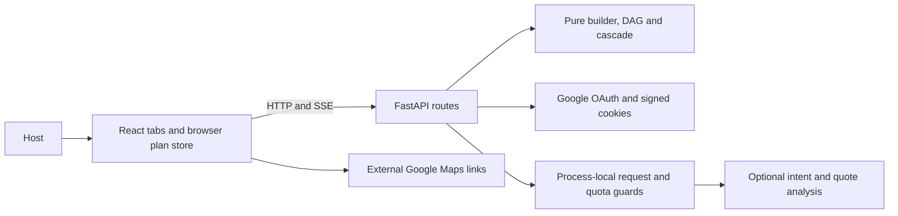

# EvePlan

EvePlan turns host-selected events into a multi-day celebration plan with task dependencies, guest counts, budgets and vendor quotations. Google sign-in protects account-specific browser storage. A pure Python engine computes the plan; optional Groq interprets changes and compares written offers. Vendor discovery opens keyless Google Maps search links.

[Live application](https://eveplan-beige.vercel.app) · [Architecture](docs/architecture.md) · [Supported workflows](docs/requirements.md)



## Quickstart

Use Python 3.12+, Node 24 and pnpm 12.6.0. From the repository root in PowerShell:

```powershell
python -m venv .venv
.venv/Scripts/python.exe -m pip install --require-hashes -r backend/requirements-dev.lock
Copy-Item .env.example .env
.venv/Scripts/python.exe -m uvicorn app.main:app --app-dir backend --reload --port 8000
```

In another terminal:

```powershell
cd frontend
pnpm install --frozen-lockfile
pnpm run dev
```

Open `http://localhost:5173`. Configure Google sign-in using [auth.md](docs/auth.md) before celebration setup. Groq is optional. For isolated local tests, `AUTH_REQUIRED=false` enables the offline workflow; Vercel always requires login. On Linux/macOS, use `.venv/bin/python`.

[Setup and environment variables](docs/setup.md) · [Google OAuth](docs/auth.md) · [Vercel and Cloud Run](docs/deployment.md)

## Quality checks

Run every gate with the same entry point used by CI, from the repository root:

```powershell
.venv/Scripts/python.exe scripts/check.py
```

The runner starts an offline API on port 8018 when needed and records logs under `.tools/quality/`. It also checks Python formatting and public docstrings. The individual commands are:


From `backend/`, with the virtual environment active:

```text
ruff check app/ tests/
mypy --strict app/
pytest --cov=app --cov-report=json --cov-fail-under=70
coverage report --include="app/engine/*" --fail-under=80
bandit -r app/ --exclude app/static -s B101
pip-audit --disable-pip --require-hashes -r requirements-dev.lock
```

From `frontend/`:

```text
pnpm run lint
pnpm run check:unused
pnpm run test:coverage
pnpm run build
pnpm audit
pnpm run test:smoke
```

The smoke test expects an API on `127.0.0.1:8018`; start Uvicorn with that port first. It uses local Chrome, or Playwright Chromium in CI. Install CI Chromium with `pnpm exec playwright install --with-deps chromium`. Frontend coverage enforces 70% lines, with generated types and the DOM entry point excluded. API coverage enforces 70% overall and 80% on the engine. The purity, SSE, provider, axe-on-every-tab and browser smoke checks are included. [Hosted CI](https://github.com/avz-sharma/EvePlan/actions/workflows/quality.yml) also builds the container, verifies its non-root user, and scans all Git history with checksum-verified Gitleaks.

OpenAPI output is in `backend/openapi.json`; regenerate frontend declarations with `pnpm run sync-types` after updating it.

## Five-minute demo

Sign in first, or use the isolated local bypass described above.


1. Start with Groq unset. Choose the three-day example, then enter a name, 120 guests, city, date, your total budget range and per-plate range. Review, then build. Each event defaults to 120 guests.
2. Open Events, change one event's attendance, and move an event between days. Inspect the Timeline and Budget updates.
3. Describe `+40 guests`. Inspect the streamed result, then undo and redo it.
4. Fork a plan. In Quotes, choose a day, event and category, enter the vendor’s written offer, and select the finalized quote for budget. Inspect budget/task changes and switch branches to compare them.
5. Compare a written quote using values you enter. Reload the page to demonstrate saved-plan restoration.
