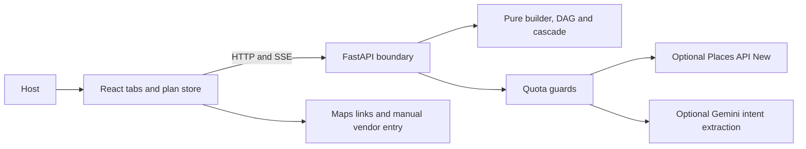

# EvePlan

EvePlan builds a multi-day celebration plan from the events a host chooses. It coordinates event dates, task dependencies, guest counts, host-entered budgets, and vendor choices. There is no religion question or religion field.

The React app keeps plan branches in browser storage. A deterministic Python engine rebuilds tasks and budgets; optional Gemini interprets a change request. Vendor search uses Google Places API (New), with Google Maps links and manual entry when keys or quota are unavailable. The supplied EvePlan PNG is the application logo.



## Local setup

Use Python 3.12 or newer, Node 24 or newer, and pnpm 12.6.0. CI and the container use Python 3.12. From the repository root in PowerShell:

```powershell
python -m venv .venv
.venv/Scripts/python.exe -m pip install --require-hashes -r backend/requirements-dev.lock
Copy-Item .env.example .env
.venv/Scripts/python.exe -m uvicorn app.main:app --app-dir backend --reload --port 8000
```

In a second terminal:

```powershell
cd frontend
pnpm install --frozen-lockfile
pnpm run dev
```

Open `http://localhost:5173`. API health is at `http://localhost:8000/health`; locally hosted Swagger and ReDoc are at `/docs` and `/redoc`. API settings and Vite both read the root `.env`. Environment variables override files. On Linux/macOS, use `.venv/bin/python` instead of the Windows Python path.

## Environment and keys

All keys are optional. Start with empty values to use the deterministic and manual workflows.

| Variable | Purpose |
| --- | --- |
| `GEMINI_API_KEY` | Server secret for optional intent extraction. |
| `GEMINI_MODEL` | Model identifier; defaults to `gemini-2.5-flash-lite`. |
| `GOOGLE_PLACES_API_KEY` | Server secret restricted to Places API (New). |
| `VITE_GOOGLE_MAPS_BROWSER_KEY` | Public browser key restricted to Maps JavaScript API and the app's exact HTTP referrers. |
| `GOOGLE_PLACES_RPM_LIMIT`, `GOOGLE_PLACES_DAILY_LIMIT` | Per-process Places request limits; default 5/minute and 100/day. |
| `ALLOWED_ORIGINS` | JSON array of exact HTTP(S) frontend origins; wildcards and paths are rejected. |
| `MAX_REQUEST_BYTES`, `API_REQUESTS_PER_MINUTE` | Request-body and per-client abuse limits; defaults 6 MiB and 240/minute. |
| `VITE_API_BASE_URL` | API origin or relative base; empty uses the same origin and Vite's local `/api` proxy. |

Never put the server key in a `VITE_*` variable. Browser variables are included in the public build. Restrict the server key to Places API (New); restrict the browser key by HTTP referrer and API. Search requests use a limited field mask; rating and contact details require an explicit click. Plans persist only Place IDs and host-authored notes, quotes, capacity and caps. Display content is fetched again. Places display content is used only for the current view; the short-lived cache retains IDs only.

## Free-tier operation and data limits

- A replan makes at most one optional Gemini call. Its rationale is built from checked engine output. Missing keys and provider/quota errors use deterministic fallback parsing.
- The application and provider quota guards are held in memory. Cold starts reset them. Keep one API worker and one Cloud Run instance for this deployment, and configure Google project quotas separately. Application limits do not guarantee zero billing; check current model and SKU availability in the Google project.
- The 30-second Places cache contains only IDs and does not avoid charged display-content searches. Places results are displayed with a Google map; missing Maps configuration switches the UI to deep links and manual entry.
- Prices come from host-entered per-plate ranges and quotes. Unquoted categories remain unestimated. Percentages in `planning_heuristics.py` are planning heuristics, not market rates.
- The catalog is a community-review starter. The referenced Appendix A was absent from the original checkout. Hosts can add custom events and confirm their own needs.
- Quote comparison uses manually entered written-quote values. Automatic upload extraction is unavailable; the legacy upload endpoint validates files and returns 501. Upload validation has a fixed 5 MiB cap.

## Quality checks

From `backend/`, with the virtual environment active:

```text
ruff check app/ tests/
mypy --strict app/
pytest --cov=app --cov-report=json --cov-fail-under=70
coverage report --include="app/engine/*" --fail-under=80
bandit -r app/ --exclude app/static -s B101
pip-audit --disable-pip --require-hashes -r requirements-dev.lock
```

From `frontend/`:

```text
pnpm run lint
pnpm run check:unused
pnpm run test:coverage
pnpm run build
pnpm audit
pnpm run test:smoke
```

The smoke test expects an API on `127.0.0.1:8018`; start Uvicorn with that port first. It uses local Chrome, or Playwright Chromium in CI. Install CI Chromium with `pnpm exec playwright install --with-deps chromium`. Frontend coverage enforces 70% lines, with generated types and the DOM entry point excluded. API coverage enforces 70% overall and 80% on the engine. The purity, SSE, provider, axe-on-every-tab and browser smoke checks are included. [Hosted CI](https://github.com/avz-sharma/EvePlan/actions/workflows/quality.yml) also builds the container, verifies its non-root user, and scans all Git history with checksum-verified Gitleaks.

OpenAPI output is in `backend/openapi.json`; regenerate frontend declarations with `pnpm run sync-types` after updating it.

## Deploy

Build and check the API image:

```text
docker build -t eveplan-api .
docker run --rm -p 8080:8080 eveplan-api
```

The image builds wheels from the hashed runtime lockfile, runs as UID 10001, and exposes `/health`. For Cloud Run, create a local `deploy.env.yaml` with non-secret configuration such as:

```yaml
ALLOWED_ORIGINS: '["https://your-site.example"]'
GOOGLE_PLACES_RPM_LIMIT: '5'
GOOGLE_PLACES_DAILY_LIMIT: '100'
```

```text
gcloud run deploy eveplan-api --source . --region asia-south1 --allow-unauthenticated --min-instances 0 --max-instances 1 --concurrency 8 --timeout 300 --cpu 1 --memory 512Mi --env-vars-file deploy.env.yaml
```

Use Secret Manager references for optional server keys. Build the frontend with its API base and optional browser key, then publish `frontend/dist` on a static host that supports `_headers` (for example Netlify or Cloudflare Pages). Other hosts must apply the generated headers themselves. The build emits CSP and security headers, adds the configured API origin to `connect-src`, and gives hashed assets/fonts a one-year immutable cache policy. HTML revalidates. Publish Terms of Use and a Privacy Policy incorporating Google's terms before enabling Places publicly. No live application URL is claimed until a service is actually deployed.

## Five-minute demo

1. Start with both Maps keys and Gemini unset. Choose the three-day example, then enter a name, 120 guests, city, date, your total budget range and per-plate range. Review, then build. Each event defaults to 120 guests.
2. Open Events, change one event's attendance, and move an event between days. Inspect the Timeline and Budget updates.
3. Describe `+40 guests`. Inspect the streamed result, then undo and redo it.
4. Fork a plan. In Vendors, choose an event and category, enter a manual vendor with your quote/capacity, and pick it. Inspect budget/task changes and switch branches to compare them.
5. Compare a written quote using values you enter. Reload the page to demonstrate saved-plan restoration. If testing Places with restricted keys, explicitly open details to fetch contact fields.

## Project Notes

- Performance and test measurement artifacts are kept in [docs/measurements/](docs/measurements/).
- Audit reports, requirements mapping, and deployment notes are kept locally in the audits/ folder. This folder is gitignored and is not included in GitHub checkouts.
- Automated checks run in [GitHub Actions](https://github.com/avz-sharma/EvePlan/actions/workflows/quality.yml).
- Deployment status: no live frontend or API has been published from this workspace.

