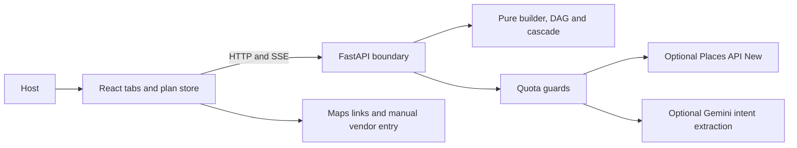

# EvePlan

EvePlan builds a multi-day celebration plan from the events a host chooses. It coordinates event dates, task dependencies, guest counts, host-entered budgets, and vendor choices. There is no religion question or religion field.

Google sign-in comes before the celebration setup wizard. The React app keeps plan branches in account-specific browser storage. A deterministic Python engine rebuilds tasks and budgets; optional Gemini interprets a change request. Vendor discovery uses free Google Maps search URLs and manual entry. No Maps API key or billing account is needed. The supplied EvePlan PNG is the application logo.



## Local setup

Use Python 3.12 or newer, Node 24 or newer, and pnpm 12.6.0. CI and the container use Python 3.12. From the repository root in PowerShell:

```powershell
python -m venv .venv
.venv/Scripts/python.exe -m pip install --require-hashes -r backend/requirements-dev.lock
Copy-Item .env.example .env
.venv/Scripts/python.exe -m uvicorn app.main:app --app-dir backend --reload --port 8000
```

In a second terminal:

```powershell
cd frontend
pnpm install --frozen-lockfile
pnpm run dev
```

Open `http://localhost:5173`. API health is at `http://localhost:8000/health`; locally hosted Swagger and ReDoc are at `/docs` and `/redoc`. API settings and Vite both read the root `.env`. Environment variables override files. Configure Google OAuth as described below before signing in; use AUTH_REQUIRED=false only for isolated local tests. On Linux/macOS, use `.venv/bin/python` instead of the Windows Python path.

## Environment and keys

Gemini is optional. Google OAuth credentials are required for sign-in; AUTH_REQUIRED=false enables isolated local testing only. Vendor discovery needs no API key.

| Variable | Purpose |
| --- | --- |
| `GEMINI_API_KEY` | Server secret for optional intent extraction. |
| `GEMINI_MODEL` | Model identifier; defaults to `gemini-2.5-flash-lite`. |
| `ALLOWED_ORIGINS` | JSON array of exact HTTP(S) frontend origins; wildcards and paths are rejected. |
| `MAX_REQUEST_BYTES`, `API_REQUESTS_PER_MINUTE` | Request-body and per-client abuse limits; defaults 6 MiB and 240/minute. |
| `VITE_API_BASE_URL` | API origin or relative base; empty uses the same origin and Vite's local `/api` proxy. |

Vendor discovery builds a URL in your browser from the selected service, event type, location and optional keyword. Click Find, then Search on Google Maps to open Google Maps externally. No search API is called and no listings, ratings or availability are imported. Add a vendor and their written offer in Quotes, then select the finalized quote for an event in Plan A or B. Template briefs and interview questions remain available.

Maps URLs require no Google key or billing: `api=1` is the URL protocol version. See [Google’s official documentation](https://developers.google.com/maps/documentation/urls/get-started). No feature in this app now requires Maps/Places billing. Optional Gemini is separate and unchanged.

## Free-tier operation and data limits

- A replan makes at most one optional Gemini call. Its rationale is built from checked engine output. Missing keys and provider/quota errors use deterministic fallback parsing.
- The application and provider quota guards are held in memory. Cold starts reset them. Keep one API worker and one Cloud Run instance for this deployment, and configure Google project quotas separately. Application limits do not guarantee zero billing; check current model and SKU availability in the Google project.
- Vendor discovery makes no external requests until you open a Maps link. Keep private details out of search keywords.
- Prices come from host-entered per-plate ranges and quotes. Unquoted categories remain unestimated. Percentages in `planning_heuristics.py` are planning heuristics, not market rates.
- The catalog is a community-review starter. The referenced Appendix A was absent from the original checkout. Hosts can add custom events and confirm their own needs.
- Quote comparison uses manually entered written-quote values. Automatic upload extraction is unavailable; the legacy upload endpoint validates files and returns 501. Upload validation has a fixed 5 MiB cap.

## Saved quotations and budget selection

Use Quotes → Add a Manual Quote, choose a day, event and service, then enter the original and finalized amounts. Save Quote keeps an alternative without changing spending; Save & Select for Budget replaces the allocation for that event/service. Vendors → Compare Saved Quotes shows the same records, missing terms, savings and budget fit, with optional Analyze with AI. AI suggestions never select a vendor.

Existing manually assigned vendors keep their allocations until a quotation replaces them. Deleting the selected quote removes its cost; unquoted catering returns to the entered per-plate range. Removing an event/day also removes its linked quotations, and undo restores them. The plan-wide contingency defaults to 10%, is editable from 0–100% in Budget, and is applied once. Branches retain independent quotations and selections in account-specific browser storage.

## Quality checks

From `backend/`, with the virtual environment active:

```text
ruff check app/ tests/
mypy --strict app/
pytest --cov=app --cov-report=json --cov-fail-under=70
coverage report --include="app/engine/*" --fail-under=80
bandit -r app/ --exclude app/static -s B101
pip-audit --disable-pip --require-hashes -r requirements-dev.lock
```

From `frontend/`:

```text
pnpm run lint
pnpm run check:unused
pnpm run test:coverage
pnpm run build
pnpm audit
pnpm run test:smoke
```

The smoke test expects an API on `127.0.0.1:8018`; start Uvicorn with that port first. It uses local Chrome, or Playwright Chromium in CI. Install CI Chromium with `pnpm exec playwright install --with-deps chromium`. Frontend coverage enforces 70% lines, with generated types and the DOM entry point excluded. API coverage enforces 70% overall and 80% on the engine. The purity, SSE, provider, axe-on-every-tab and browser smoke checks are included. [Hosted CI](https://github.com/avz-sharma/EvePlan/actions/workflows/quality.yml) also builds the container, verifies its non-root user, and scans all Git history with checksum-verified Gitleaks.

OpenAPI output is in `backend/openapi.json`; regenerate frontend declarations with `pnpm run sync-types` after updating it.

## Deploy

Build and check the API image:

```text
docker build -t eveplan-api .
docker run --rm -p 8080:8080 eveplan-api
```

The image builds wheels from the hashed runtime lockfile, runs as UID 10001, and exposes `/health`. For Cloud Run, create a local `deploy.env.yaml` with non-secret configuration such as:

```yaml
ALLOWED_ORIGINS: '["https://your-site.example"]'
```

```text
gcloud run deploy eveplan-api --source . --region asia-south1 --allow-unauthenticated --min-instances 0 --max-instances 1 --concurrency 8 --timeout 300 --cpu 1 --memory 512Mi --env-vars-file deploy.env.yaml
```

Use Secret Manager references for optional server keys. Build the frontend with its API base, then publish `frontend/dist` on a static host that supports `_headers` (for example Netlify or Cloudflare Pages). Other hosts must apply the generated headers themselves. The build emits CSP and security headers, adds the configured API origin to `connect-src`, and gives hashed assets/fonts a one-year immutable cache policy. HTML revalidates. The Vercel deployment is at https://eveplan-beige.vercel.app; Google sign-in is configured and required before celebration setup.

## Five-minute demo

1. Start with Gemini unset. Choose the three-day example, then enter a name, 120 guests, city, date, your total budget range and per-plate range. Review, then build. Each event defaults to 120 guests.
2. Open Events, change one event's attendance, and move an event between days. Inspect the Timeline and Budget updates.
3. Describe `+40 guests`. Inspect the streamed result, then undo and redo it.
4. Fork a plan. In Quotes, choose a day, event and category, enter the vendor’s written offer, and select the finalized quote for budget. Inspect budget/task changes and switch branches to compare them.
5. Compare a written quote using values you enter. Reload the page to demonstrate saved-plan restoration.

## Project Notes

- Performance and test measurement artifacts are kept in [docs/measurements/](docs/measurements/).
- Audit reports, requirements mapping, and deployment notes are kept locally in the audits/ folder. This folder is gitignored and is not included in GitHub checkouts.
- Automated checks run in [GitHub Actions](https://github.com/avz-sharma/EvePlan/actions/workflows/quality.yml).
- Deployment: [EvePlan on Vercel](https://eveplan-beige.vercel.app). Google sign-in is configured; new users reach celebration setup after signing in.

## Google sign-in and Vercel

Google sign-in appears before celebration setup. The backend verifies Google's authorization code with state and PKCE, then sets an eight-hour signed HttpOnly cookie. Google tokens are never stored in the browser. Plans stay local and use separate storage keys for each Google account; they do not sync between devices. Sign out clears the cookie and closes the plan UI. Already issued cookies expire naturally; rotating SESSION_SECRET invalidates all sessions.

1. Create a Google Auth Platform project and OAuth client of type **Web application**. Configure the consent audience and, in testing mode, add permitted test users. Request only openid, email and profile. This is separate from Maps/Places; vendor discovery still needs no key.
2. Add the exact authorized redirect URI `https://YOUR-DOMAIN/api/auth/callback`. For local use add `http://localhost:5173/api/auth/callback`.
3. Import this GitHub repository into Vercel with the repository root as Root Directory. The committed vercel.json builds the Vite frontend and serves FastAPI through api/index.py on the same origin. Do not set a separate frontend root or VITE_API_BASE_URL.
4. Set server environment variables in Vercel: GOOGLE_OAUTH_CLIENT_ID, GOOGLE_OAUTH_CLIENT_SECRET, SESSION_SECRET (a randomly generated value of at least 32 characters), APP_ORIGIN (the stable HTTPS domain with no trailing slash), and AUTH_REQUIRED=true. Store secrets in Vercel, never in source or chat. Redeploy after setting them and register the same domain in Google.
5. Verify login, setup, reload and logout on that stable domain. Callback URIs for random previews must be registered separately; use the stable production domain for sign-in.

For isolated local testing only, AUTH_REQUIRED=false enables the existing offline workflow. Vercel always enforces login even if this flag is false. Production with missing credentials stays locked and shows a setup-pending message. The CI smoke API explicitly sets the local bypass and mocks sign-in in dedicated tests. In-memory quota/rate guards remain per function instance on Vercel; enforce optional provider project quotas separately.

Setup references: [Google OAuth web server flow](https://developers.google.com/identity/protocols/oauth2/web-server), [Vercel Python runtime](https://vercel.com/docs/functions/runtimes/python). The app is deployed at [eveplan-beige.vercel.app](https://eveplan-beige.vercel.app). Google OAuth credentials are configured, and the live authorization redirect has been verified to reach Google’s sign-in page. Completing Google account sign-in then returns to the celebration setup workflow. The registered callback must be `https://eveplan-beige.vercel.app/api/auth/callback`.
