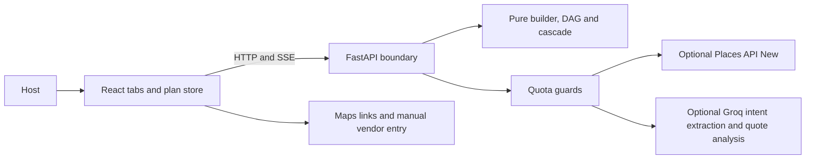

# Architecture and data flow

The API owns catalog I/O, provider calls, authentication and request guards. The engine receives the catalog and current date as arguments and performs no network or file I/O. Plan state and branch histories live in the browser; there is no database.

## Provider and data limits

- A replan makes at most one optional Groq call. Its rationale is built from checked engine output. Missing keys and provider/quota errors use deterministic fallback parsing.
- The application request guard is held in memory. Cold starts reset it. Keep one API worker and one Cloud Run instance for this deployment. Application limits do not guarantee zero billing; check your Groq account usage and pricing in the Groq Console.
- Vendor discovery makes no external requests until you open a Maps link. Keep private details out of search keywords.
- Prices come from host-entered per-plate ranges and quotes. Unquoted categories remain unestimated. Percentages in `planning_heuristics.py` are planning heuristics, not market rates.
- The catalog is a community-review starter. Hosts can add custom events and confirm their own needs.
- Quote comparison uses manually entered written-quote values. Automatic upload extraction is unavailable; the legacy upload endpoint validates files and returns 501. Upload validation has a fixed 5 MiB cap.

## Saved quotations

Use Quotes → Add a Manual Quote, choose a day, event and service, then enter the original and finalized amounts. Save Quote keeps an alternative without changing spending; Save & Select for Budget replaces the allocation for that event/service. Vendors → Compare Saved Quotes shows the same records, missing terms, savings and budget fit. Optional Groq analysis recommends one vendor, shows advantages and trade-offs for each quote, and lists missing terms and follow-up questions. The host makes the final selection.

Existing manually assigned vendors keep their allocations until a quotation replaces them. Deleting the selected quote removes its cost; unquoted catering returns to the entered per-plate range. Removing an event/day also removes its linked quotations, and undo restores them. The plan-wide contingency defaults to 10%, is editable from 0–100% in Budget, and is applied once. Branches retain independent quotations and selections in account-specific browser storage.

